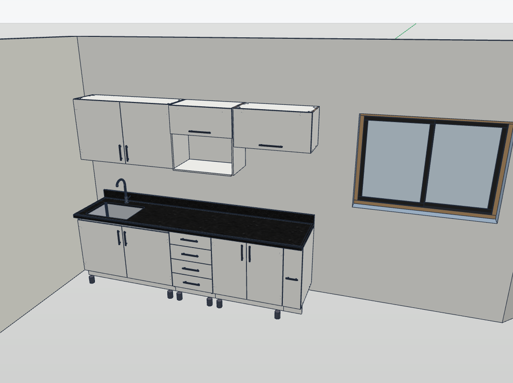
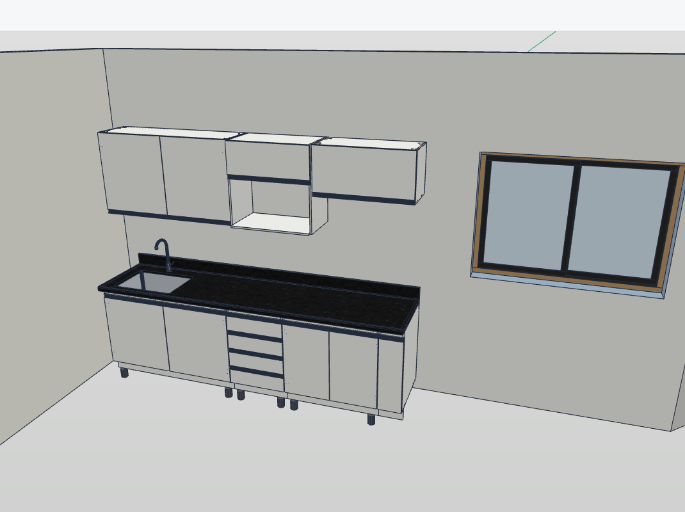
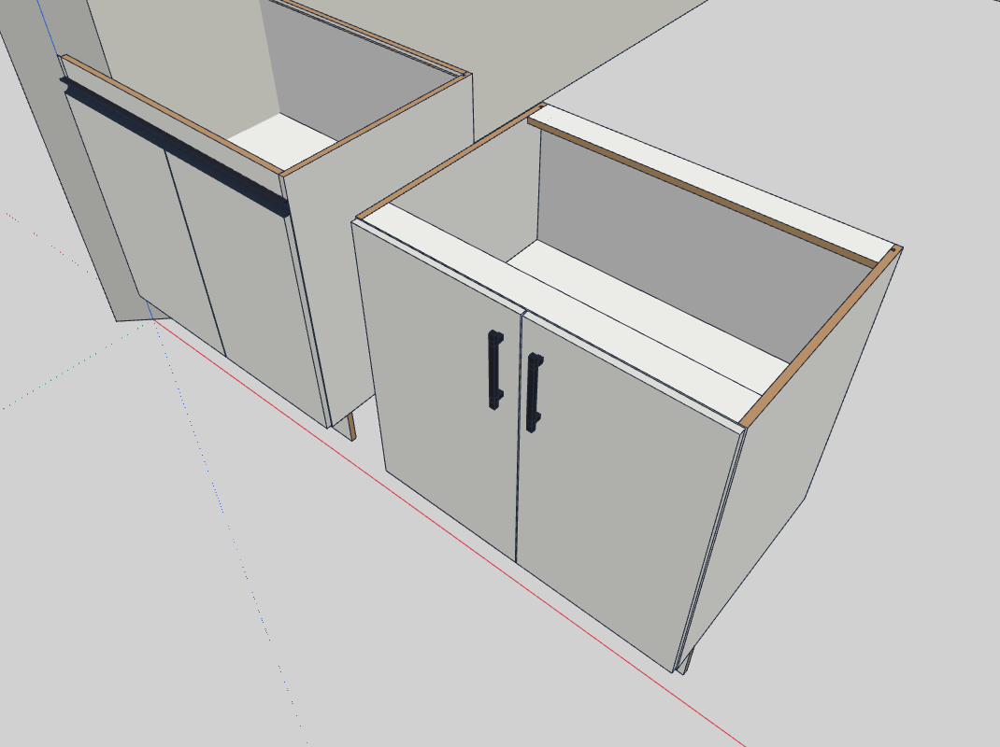
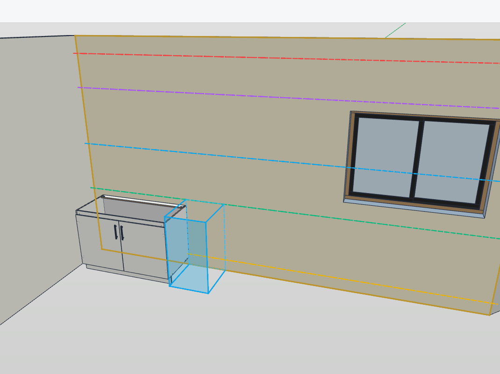
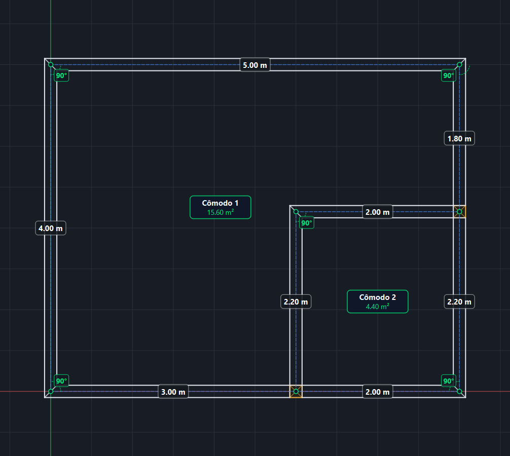
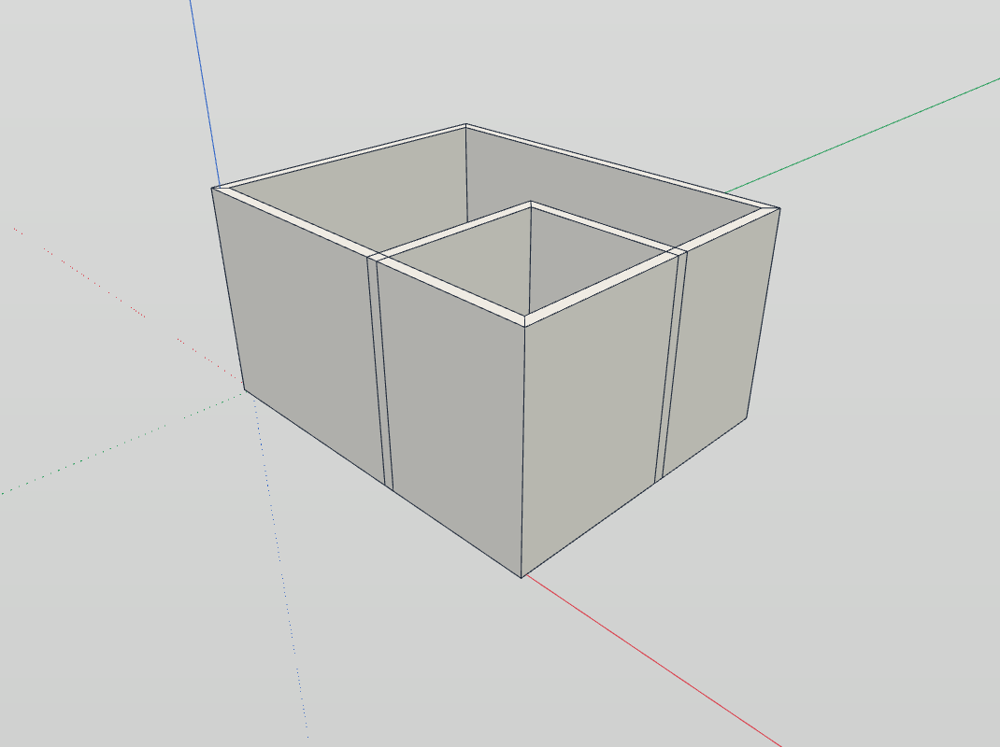
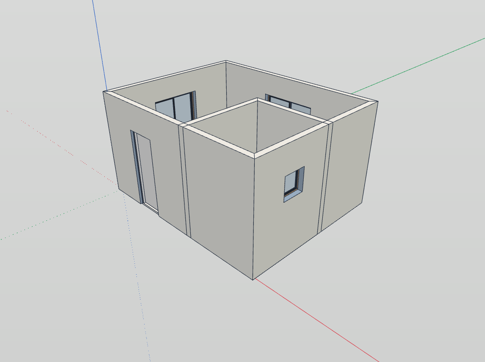

  <a href="README.md">Português</a> | <b>English</b>

# TrazoMob — Parametric Cabinetry, Woodworking & 3D Architecture for IngeTrazo

**TrazoMob** is a professional extension for [IngeTrazo CAD 3D](https://github.com/ingelibre/ingetrazo) focused on custom millwork/cabinetry, interior design, parametric room modeling, architectural openings (doors and windows), and integrated cutlist optimization.

---

## 🚀 Key Features

### 🪵 1. Parametric Cabinetry Modules
* **Comprehensive Catalog:** Base cabinets, wall/upper units, appliance towers, drawer units, pantries, straight corners, and L-shaped corner cabinets.
* **Standard 1000 × 1000 Corner Dimensions:** The L-corner base unit is square by definition; its dual doors overlap cleanly, with an optional **inner corner stop**.
* **Automatic Sizing & Partitions:** Door cabinets follow ergonomic width sizing rules (standard 400 mm per door), automatically inserting structural center partitions from 3 doors onward.
* **Parametric Countertops:** Straight and L-shaped countertops with customizable thickness build-up (apron/skirt) and backsplashes.
* **Real-Time Millimetric Adjustments:** Direct dynamic editing of width, height, depth, toe-kick recess, and panel thicknesses (15mm, 18mm, 25mm).
* **Interactive 3D Viewport:** Click interactively to open and close swing doors, lift-up flaps, and drawers directly in the 3D scene.

| Kitchen with External Pull Handles & Granite Countertop | Kitchen with Integrated J-Pull Profile & Vertical Stretchers |
| :---: | :---: |
|  |  |
| *External pull handles, granite countertop with undermount sink, and upper cabinets* | *Continuous aluminum J-pull profile (gola) and structural vertical stretchers* |

  
   
  <em>Construction detail: On the left, base cabinet with upright vertical stretchers and J-pull profile; on the right, base cabinet with flat horizontal stretchers and external pull handles</em>

### 🧲 2. Magnetic Snapping & Smart Placement
* **Magnetic Wall Snapping:** Modules automatically detect walls, snapping and aligning their back panel flush to the masonry with automatic orientation.
* **Module-to-Module Snapping:** Snap base and wall units side-by-side with automatic magnetic latching and flush front alignment.
* **Elevation Guides & Insertion Frame:** Selecting a wall projects standardized reference guide lines (toe-kick, countertop, wall cabinets) directly on the surface, along with a **3D Snap Frame** (contiguous slot) showing the exact millimetric position of the next adjacent module.
* **Equal Spacing Distribution:** Automatically spaces selected cabinets uniformly across open spans between architectural boundaries.
* **Projected Dynamic Dimensions:** Real-time projected HUD dimension lines (in mm) displaying clear distances to wall corners or adjacent cabinets during mouse drag.
* **Custom Height Guides Editor:** Customize standard elevation guidelines tailored per room type (Kitchen, Bedroom, Bathroom, Office).

  
   
  <em>Inner face of the selected wall with parametric elevation reference lines: existing base cabinet inserted and translucent cyan 3D Frame (armed slot) indicating millimetric positioning for the next module</em>

### 🧱 3. Smart Walls & 2D Floor Plan
* **Interactive 2D Floor Plan:** Draw closed floor layouts or freestanding wall segments in 2D with customizable thickness and ceiling height.
* **Automated 3D Room Generation:** Instantaneous one-click extrusion of solid, watertight 3D walls, floor slabs, and ceilings.
* **Manifold Solid Geometry:** Mitered corner joints with seamless, watertight geometry and zero internal non-manifold faces.
* **Automatic Wall Fill:** Select a wall face to generate contiguous modular runs that precisely fill the span — **base cabinets**, **drawer units**, or **upper cabinets**. Any remaining clearance is evenly distributed, wrapped in a single undo step.
* **Selective Wall Visibility:** Easily toggle individual wall visibility to inspect and design room interiors without obstruction.

| 2D Floor Plan Builder (Dimensions & Rooms) | Generated 3D Walls & Rooms |
| :---: | :---: |
|  |  |
| *2D drafting with dynamic dimensioning, T-junctions, and real-time area calculation* | *Instant 3D solid extrusion with clean miter joints and flooring* |

### 🚪 4. Integrated Openings (Doors & Windows)
* **Automatic Wall Cutouts:** Inserting a door or window automatically carves exact openings into the host wall mesh, maintaining solid, watertight geometry.
* **Jamb & Sill Dimensioning:** HUD projected dimension lines indicate real-time distances to corners, as well as vertical dimensions for windows (sill height, rough opening, header).
* **Live Drag Relocation:** Dragging an opening with the mouse or editing dimensions via the sidebar repositions the wall cutout in real time.
* **Full Undo / Redo (Ctrl+Z):** Fully integrated into IngeTrazo's transaction history — undoing placement or relocation cleanly restores the original solid wall.

  
   
  <em>Room with doors and windows inserted, featuring live automatic wall opening cutouts</em>

### 💡 5. Decorative Lighting
* **LED Strip Channels & Recessed Spots:** Add linear and directional spotlight fixtures underneath wall cabinets, panels, and coves.
* **Viewport Light Cones:** Visual cones and direction paths rendered directly in the 3D viewport for precise photometric alignment.

### 📋 6. Cutlist & Production
* **Comprehensive Parts List:** Automatic panel classification (sides, bottom, shelves, top, stretchers, fronts, and backboards).
* **Edge Banding Management:** Granular edge banding assignment per face (top, bottom, left, right) with thickness presets (0.45mm, 1.0mm, 2.0mm).
* **2D Sheet Cutting Optimizer:** Nesting engine optimizing panel layout on standard sheet boards (e.g. MDF), supporting grain direction, blade kerf, and margin trimming.
* **Export:** One-click export to printable PDF production reports and CSV spreadsheets.

---

## 📦 Installation

### Option 1: Via IngeTrazo Extension Manager (Recommended)
1. In IngeTrazo, go to **Extensions ▸ Manage Extensions…**.
2. Search for **TrazoMob** and click **Download / Install**.
3. Restart the application to enable the tools and sidebar dock.

### Option 2: Manual Installation
1. Download the repository source or `.zip` from the [latest release](https://github.com/garciamauro01/trazomob/releases).
2. Extract the `trazomob` folder into the user extensions directory:
   - **Windows:** `%APPDATA%\ingetrazo\plugins\trazomob\`
   - **Linux:** `~/.local/share/ingetrazo/plugins/trazomob/`
3. Launch IngeTrazo. The **TrazoMob** panel will appear docked on the right side.

---

## 🛠️ Requirements & Compatibility

* **IngeTrazo CAD 3D:** Version `0.1.0` or higher.
* **Operating System:** Windows 10/11 or Linux.
* **Dependencies:** `PySide6`, `numpy`, `trimesh` (bundled with IngeTrazo).

* **Official Documentation:** See the [TrazoMob Operation Manual (PT)](docs/MANUAL_DE_OPERACAO_TRAZOMOB.md), the [Lighting & Photorealistic Rendering Manual (PT)](docs/MANUAL_ILUMINACAO.md), and the [Architecture Overview (PT)](docs/ARQUITETURA.md).

---

## 📄 License

Distributed under the **GPL-3.0-or-later** license. See the project license file for full terms and conditions.
