

  <b>Português</b> | <a href="README.en.md">English</a>

# TrazoMob — Modulação, Marcenaria e Arquitetura 3D para IngeTrazo

O **TrazoMob** é uma extensão profissional para o [IngeTrazo CAD 3D](https://github.com/ingelibre/ingetrazo) focada em marcenaria sob medida, projeto de interiores, modelagem paramétrica de ambientes, esquadrias e plano de corte integrado.

---

## 🚀 Principais Funcionalidades

### 🪵 1. Módulos Paramétricos de Marcenaria
* **Catálogo Completo:** Balcões baixos, armários aéreos, torres de eletrodomésticos, gaveteiros, despenseiros, cantos retos e cantos em L.
* **Medida Padrão 1000 × 1000:** O Balcão Canto L é quadrado por definição; suas duas portas são sobrepostas e opcionalmente há um **batente de quina interna**.
* **Encaixe Automático:** Balcões com portas seguem a regra de largura (400 mm por porta), com divisórias estruturais automáticas a partir da 3ª porta.
* **Bancadas Paramétricas:** Tampos retos e em L com engrossamento configurável, rodabanca e saia frontal.
* **Ajustes Milimétricos em Tempo Real:** Edição direta de largura, altura, profundidade, recuo de rodapé e espessura de chapas (15mm, 18mm, 25mm).
* **Interatividade 3D:** Clique interativo para abrir e fechar portas de giro, basculantes e gavetas diretamente na viewport.

| Cozinha com Puxador Alça e Bancada de Granito | Cozinha com Puxador Perfil Gola e Travessas em Pé |
| :---: | :---: |
| 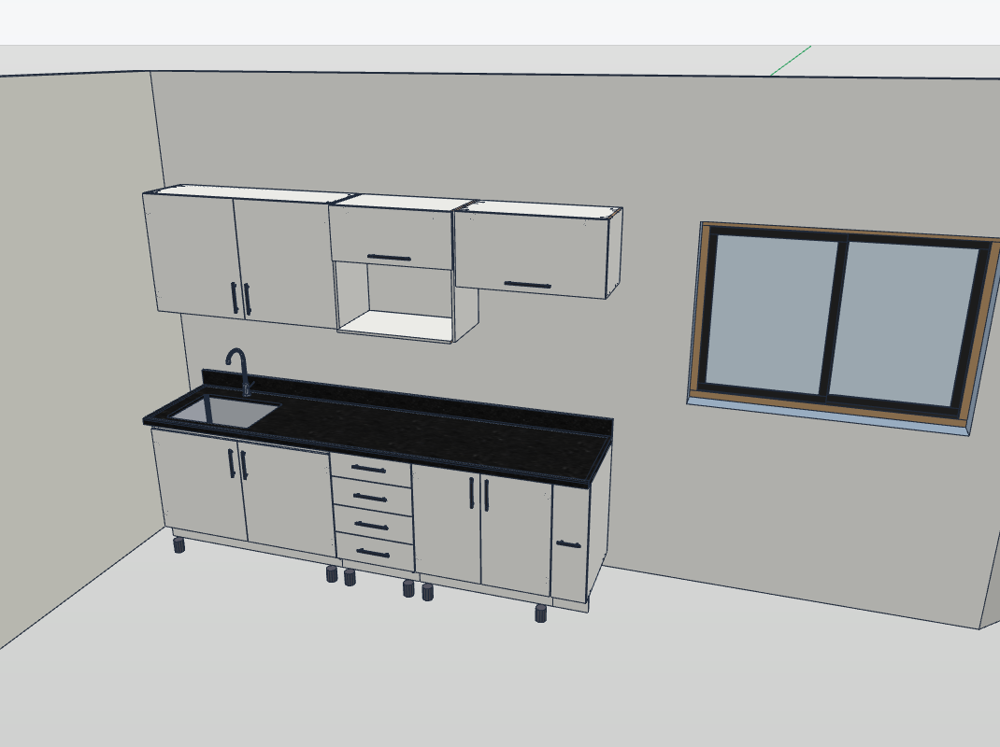 | 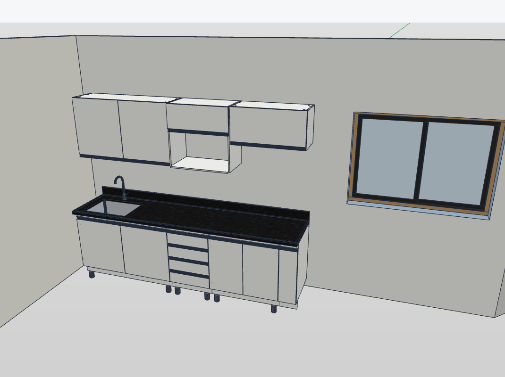 |
| *Puxadores tipo alça externos, bancada com cuba esculpida e aéreos* | *Puxador perfil de alumínio (gola contínua) e travessas estruturais verticais em pé* |

  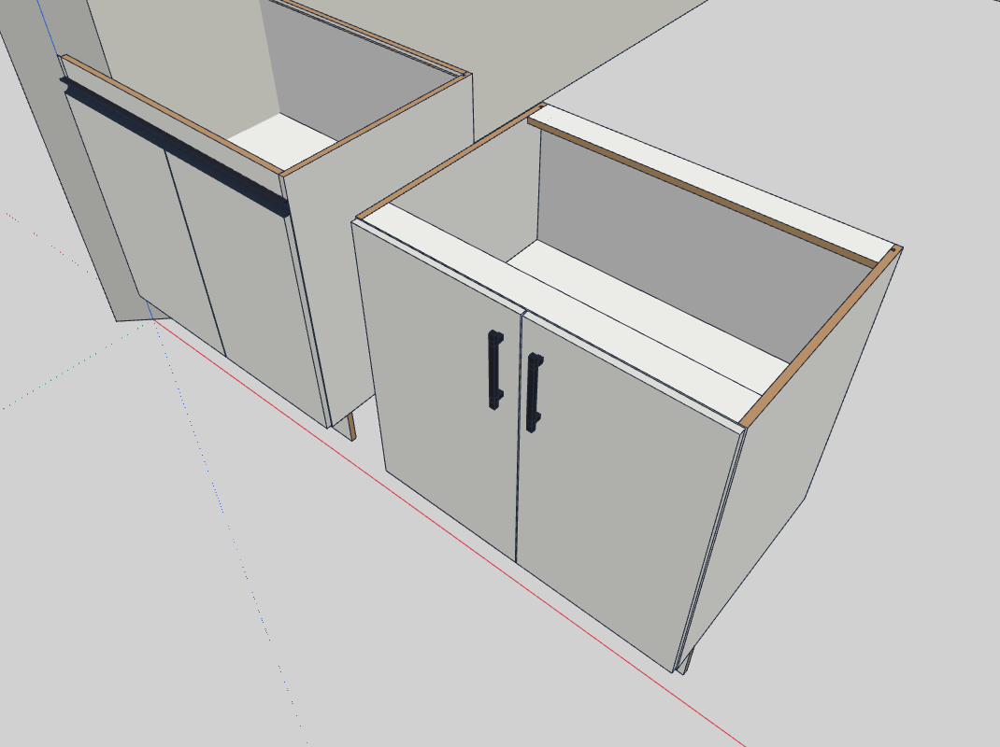
   
  <em>Detalhe construtivo: À esquerda, balcão com travessas em pé e puxador perfil gola; à direita, balcão com travessas deitadas e puxador tipo alça</em>

### 🧲 2. Snapping Magnético e Posicionamento Inteligente
* **Atração Magnética em Paredes:** Os módulos detectam e alinham automaticamente sua face traseira à alvenaria, girando e ajustando a rotação angular.
* **Encaixe Módulo a Módulo:** Encoste balcões e aéreos lado a lado com travamento automático e alinhamento de frentes.
* **Réguas de Altura e Frame de Encaixe:** Ao selecionar a parede, linhas-guia normatizadas (rodapé, bancada, aéreos) são projetadas na alvenaria com o **Frame 3D de Encaixe** (slot contíguo) mostrando exatamente onde o próximo módulo será inserido encostado ao módulo existente.
* **Distribuição de Módulos Selecionados:** Espaça uniformemente vários módulos já inseridos no vão livre entre eles.
* **Cotas Dinâmicas Projetadas:** Medição instantânea em tempo real (em mm) da distância até cantos de paredes ou módulos vizinhos durante o arraste com o mouse.
* **Editor de Réguas Personalizadas:** Configure alturas sob medida por ambiente (Cozinha, Quarto, Banheiro, Escritório).

  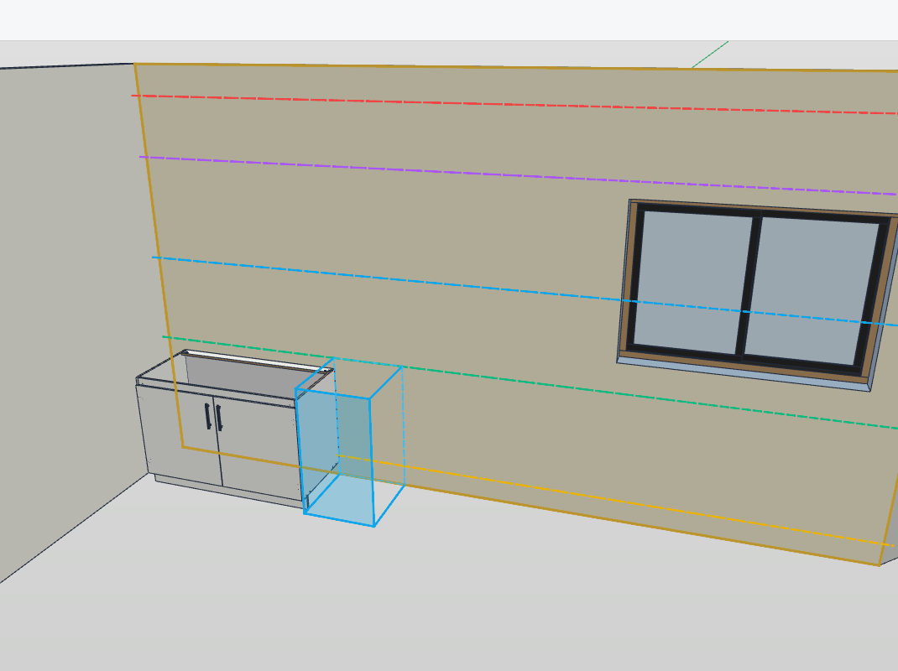
   
  <em>Face interna da parede selecionada com linhas-guia paramétricas de altura: módulo balcão existente inserido e o Frame 3D translúcido (slot armado) indicando com precisão milimétrica a posição do próximo módulo contíguo</em>

### 🧱 3. Paredes Inteligentes e Planta Baixa 2D
* **Planta Baixa Interativa:** Desenhe ambientes fechados ou paredes soltas em 2D com espessura e pé-direito configuráveis.
* **Geração Automática de Ambientes:** Criação simultânea de sólidos 3D herméticos para alvenaria, lajes de piso e forros de teto.
* **Sólidos Manifold Perfeitos:** Paredes fechadas em esquadria (miter joint), estanques (*watertight*) e sem costuras internas indesejadas.
* **Preenchimento Automático:** Selecione uma face de parede e gere módulos contíguos que fecham exatamente o vão informado — **inferiores** (balcões, gaveteiros ou misto) e **aéreos**. A sobra é distribuída entre os módulos e todo o preenchimento entra como um único passo de desfazer.
* **Visualização Seletiva:** Ferramentas para ocultar paredes individuais e visualizar o interior do cômodo sem perder a geometria.

| Construtor de Planta Baixa 2D (Cotas & Ambientes) | Paredes e Cômodos 3D Gerados |
| :---: | :---: |
| 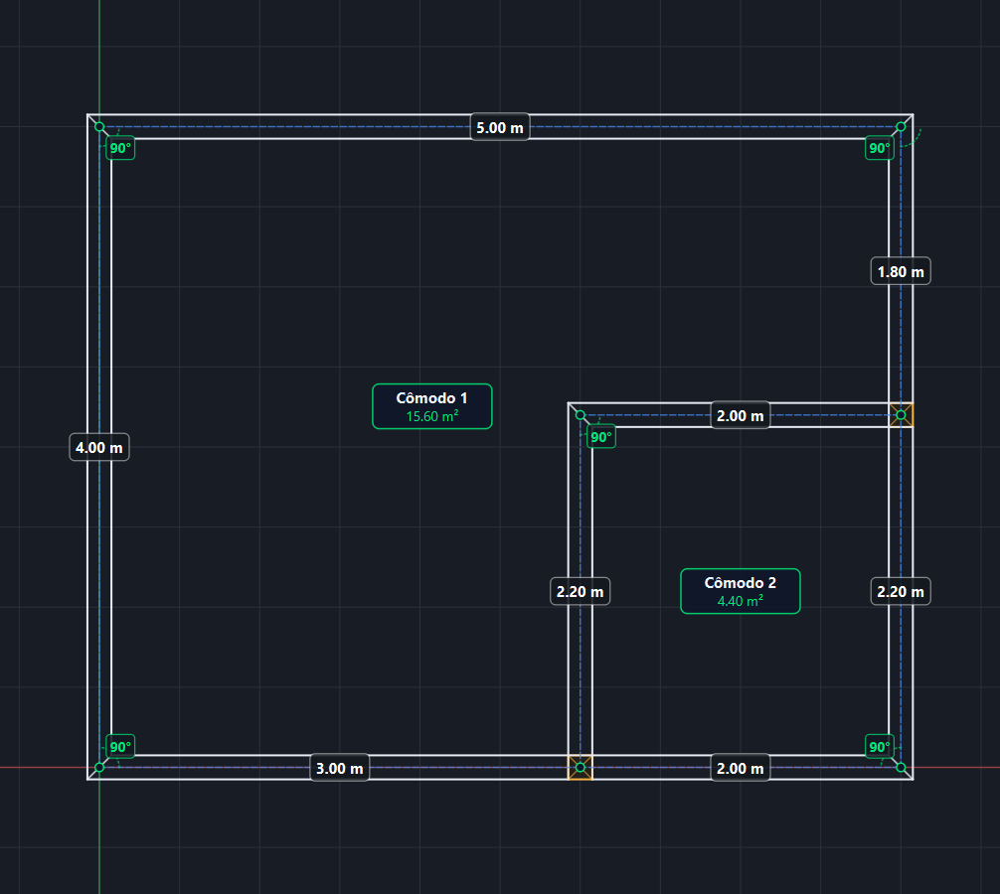 | 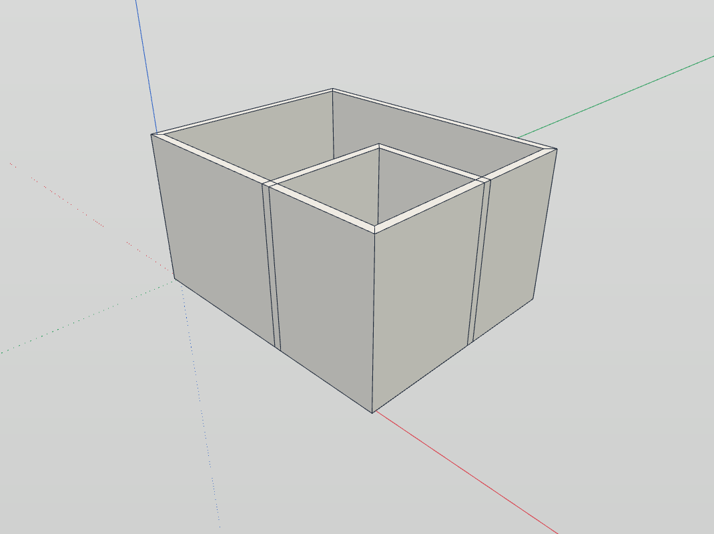 |
| *Desenho 2D com cotas dinâmicas, pilares em T e cálculo de áreas* | *Extrusão automática em 3D com junções em esquadria e pisos* |

### 🚪 4. Esquadrias Integradas (Portas e Janelas)
* **Recorte Automático de Vãos:** Inserir uma porta ou janela recorta automaticamente a alvenaria da parede hospedeira, mantendo a malha 100% sólida e estanque (*watertight*).
* **Cotas de Boneca e Peitoril:** Exibição de cotas projetadas de distância até os cantos da parede e cotas verticais para janelas (piso ao peitoril, vão e verga).
* **Acompanhamento Dinâmico:** Mover uma esquadria com o mouse ou via barra lateral reposiciona o recorte na parede em tempo real.
* **Desfazer / Refazer Completo (Ctrl+Z):** Totalmente integrado ao histórico do IngeTrazo — ao desfazer a colocação ou movimentação de uma esquadria, o recorte da parede é restaurado perfeitamente.

  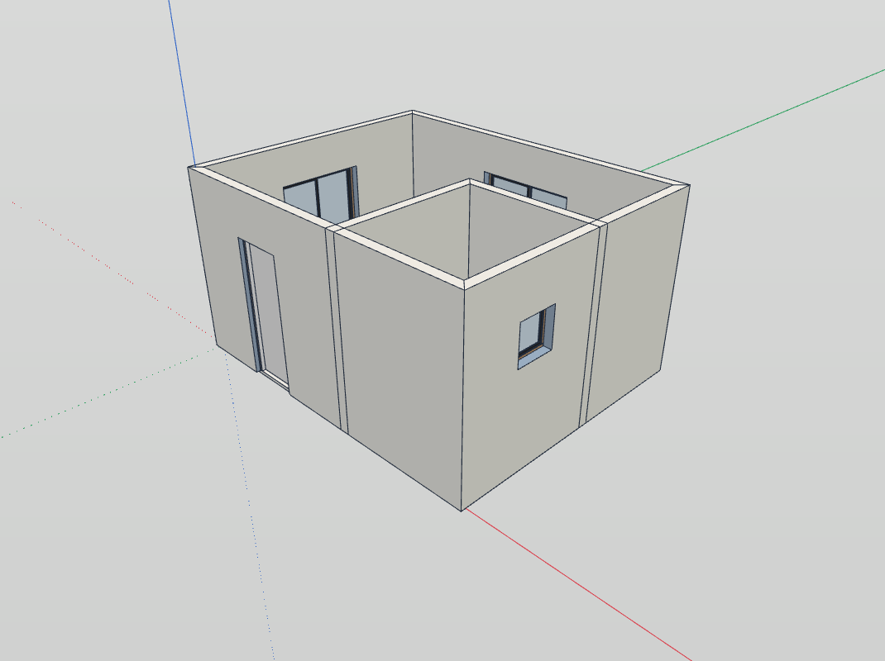
   
  <em>Ambiente com portas e janelas inseridas e paredes recortadas automaticamente em tempo real</em>

### 💡 5. Iluminação Decorativa e Fotométrica
* **Fitas de LED e Pontos de Luz (Spots):** Inserção de iluminação linear, pontos omni e spots direcionáveis sob aéreos, painéis e sancas, com ajuste de temperatura de cor em Kelvin (2400K–6500K).
* **Mira 3D e Perfis IES Reais:** Apontamento interativo de spots diretamente sobre a superfície desejada na cena e suporte a arquivos fotométricos `.ies` de fabricantes.
* **Visualizador Gráfico:** Cones de luz e traçados visíveis diretamente na viewport para conferência de projeto.

### 📸 6. Renderização Foto-Realista e Materiais PBR
* **Integração Blender Cycles / EEVEE:** Exportação direta da cena 3D sem oclusão dos gizmos de luz, com cálculo físico de fótons, sombras suaves (controle de ângulo do sol) e iluminação global com denoiser.
* **Editor de Materiais PBR e Shaders Arquitetônicos:** Calibração de rugosidade (*roughness*), relevo (*bump/normal*), verniz (*clearcoat*), materiais emissores práticos (`Emit[...]` e `EmitFake`) e shader automático **Thin Glass** para vidros simples, *reflecta* e canelados.
* **Modos de Produção Rápida:** Render em lote de todas as cenas salvas (*Batch Render*), render ultrarrápido apenas da seleção (*Render Selection*), modo **Maquete Branca (*Clay Render*)** para estudo luminotécnico e substituição automática de *proxies* (`_PROXY` → `_HIGHPOLY`).

  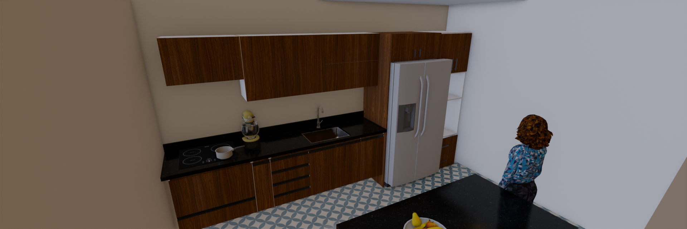
   
  <em>Renderização foto-realista de cozinha gerada pelo TrazoMob com materiais PBR, iluminação física e reflexos em bancada de granito</em>

### 📋 7. Plano de Corte e Produção (Cutlist)
* **Lista de Peças Detalhada:** Identificação automática de laterais, bases, prateleiras, tampos, réguas, frentes e fundos.
* **Fitamento de Borda:** Controle de fita de borda por face (superior, inferior, esquerda e direita) com indicação de espessuras (0.45mm, 1.0mm, 2.0mm).
* **Otimizador de Corte 2D:** Distribuição e aproveitamento das peças em chapas de MDF, com suporte a veio da madeira, largura de serra e refilo.
* **Visualizador Interativo:** Navegação entre chapas e materiais, com medidas de corte e final, fitas, furações e usinagens desenhadas sobre cada peça.
* **Aproveitamento e Sobras:** Cada chapa e o projeto inteiro exibem aproveitamento (%), área útil, retalhos aproveitáveis e metros de fita de borda.
* **Exportação:** Relatórios em PDF, planilhas CSV, diagrama da chapa em PNG e plano de corte em **DXF CNC** com camadas e furações.

  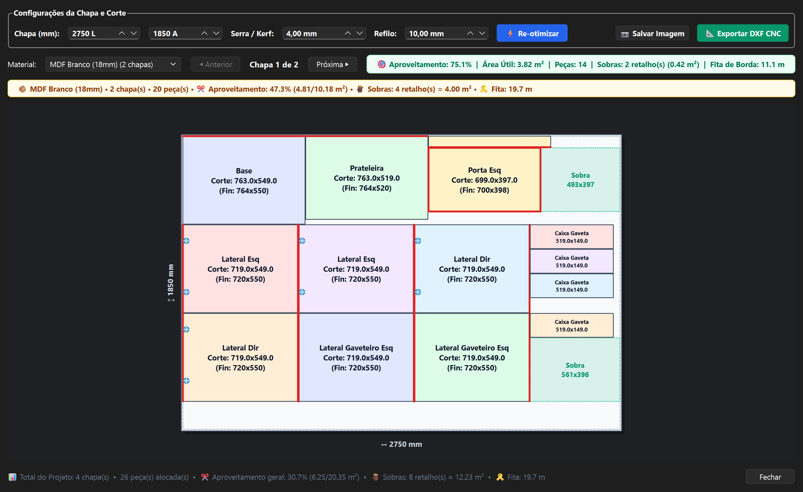
   
  <em>Visualizador do plano de corte: peças posicionadas na chapa, retalhos aproveitáveis em verde, furações de caneco e o resumo de aproveitamento por material e do projeto</em>

### 🏷️ 8. Etiquetas de Produção com Code 128 e QR
* **Código de Barras e QR Nativos:** Cada etiqueta imprime um **Code 128** real (checksum módulo 103) e um **QR Code**, desenhados pelo próprio plugin — sem dependências externas.
* **Carga Estável e Escaneável:** O código é derivado de um CRC32 determinístico, então a mesma peça gera sempre o mesmo código, em qualquer máquina ou execução.
* **Ficha Completa da Peça:** Nome, módulo de origem, medidas finais e de corte, material, quantidade, diagrama de fitas (C1/C2/L1/L2) e resumo de usinagens.
* **Pronta para Imprimir:** Visualização em lote e exportação de todas as etiquetas em PNG com resolução ampliada para impressão térmica ou A4.

  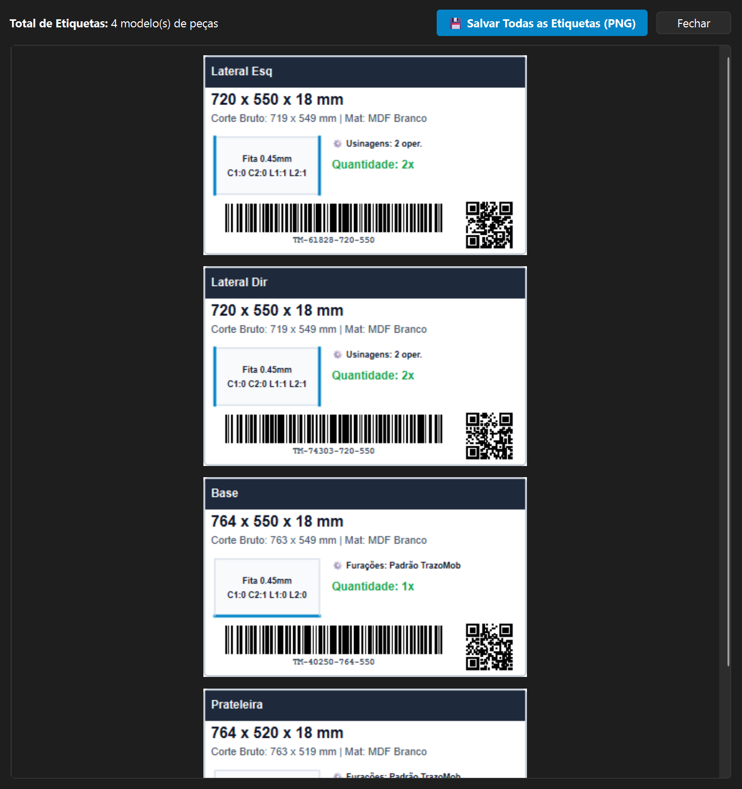
   
  <em>Etiquetas técnicas de fábrica com Code 128 escaneável, QR Code e diagrama de fitas de borda por peça</em>

### 🛠️ 9. Manual de Montagem
* **Agrupado por Módulo:** O manual organiza as peças por módulo e mostra ambiente, pavimento, quantidade de peças e ferragens.
* **Ferragens Consolidadas:** Uma única contagem de ferragens por módulo (dobradiças, corrediças, puxadores), em vez de repetir por peça.
* **Instruções de Usinagem:** Cada furo, rasgo ou rebaixo é traduzido em uma instrução de montagem com face, posição e diâmetro.
* **HTML Pronto para Imprimir:** Documento gerado automaticamente, com medidas finais e de corte, fitas de borda e ferragens, pronto para impressão ou PDF.

  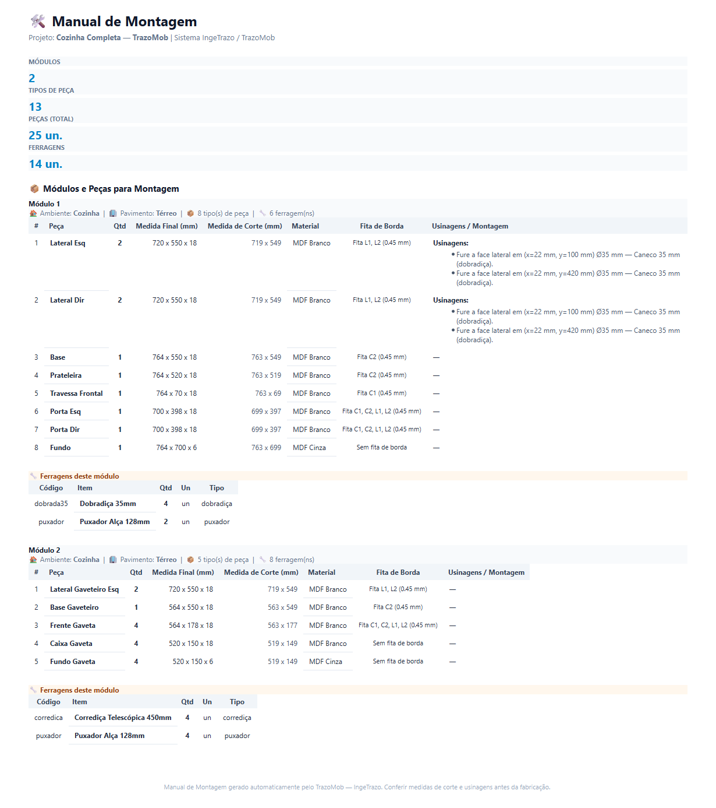
   
  <em>Manual de montagem gerado a partir da cutlist, com peças, usinagens e ferragens consolidadas por módulo</em>

### ⭐ 10. Meus Módulos
* **Salve o Módulo Atual:** Guarde qualquer configuração de módulo (dimensões, portas, gavetas, materiais e puxadores) como um modelo pessoal com um clique.
* **Categoria Dedicada:** Os módulos salvos aparecem em **⭐ Meus Módulos**, tanto na galeria quanto na aba do ribbon, prontos para reinserir na cena.
* **Persistência Local:** Os modelos ficam nas preferências do usuário (`user_modules`) e continuam disponíveis entre sessões e atualizações do plugin.

  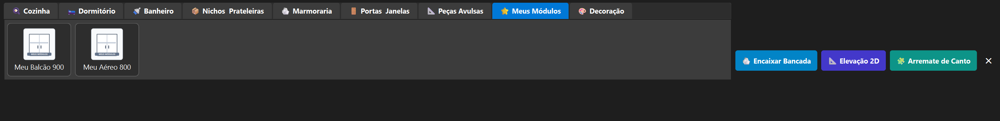
   
  <em>Aba <b>⭐ Meus Módulos</b> com modelos pessoais salvos, ao lado do catálogo estático de módulos</em>

---

## 📦 Instalação

### Opção 1: Pelo Gerenciador de Extensões do IngeTrazo (Recomendado)
1. No IngeTrazo, abra o menu **Extensões ▸ Gerenciar extensões…**.
2. Procure por **TrazoMob** e clique em **Baixar / Instalar**.
3. Reinicie o aplicativo para ativar a barra lateral e as ferramentas.

### Opção 2: Instalação Manual
1. Baixe o código do repositório ou o arquivo `.zip` da [última release](https://github.com/garciamauro01/trazomob/releases).
2. Extraia a pasta `trazomob` dentro do diretório de extensões do usuário:
   - **Windows:** `%APPDATA%\ingetrazo\plugins\trazomob\`
   - **Linux:** `~/.local/share/ingetrazo/plugins/trazomob/`
3. Inicie o IngeTrazo. A aba lateral **TrazoMob** aparecerá no dock da direita.

---

## 🛠️ Requisitos e Compatibilidade

* **IngeTrazo CAD 3D:** Versão `0.1.0` ou superior.
* **Sistema Operacional:** Windows 10/11 ou Linux.
* **Dependências:** `PySide6`, `numpy`, `trimesh` (inclusas no ambiente do IngeTrazo).

* **Documentação Oficial:** Consulte o [Manual Completo de Operação do TrazoMob](docs/MANUAL_DE_OPERACAO_TRAZOMOB.md), o [Manual de Iluminação e Render Foto-Realista](docs/MANUAL_ILUMINACAO.md) e a [Visão Geral da Arquitetura](docs/ARQUITETURA.md).

---

## 📄 Licença

Distribuído sob a licença **GPL-3.0-or-later**. Consulte o arquivo de licença do projeto para mais detalhes.
